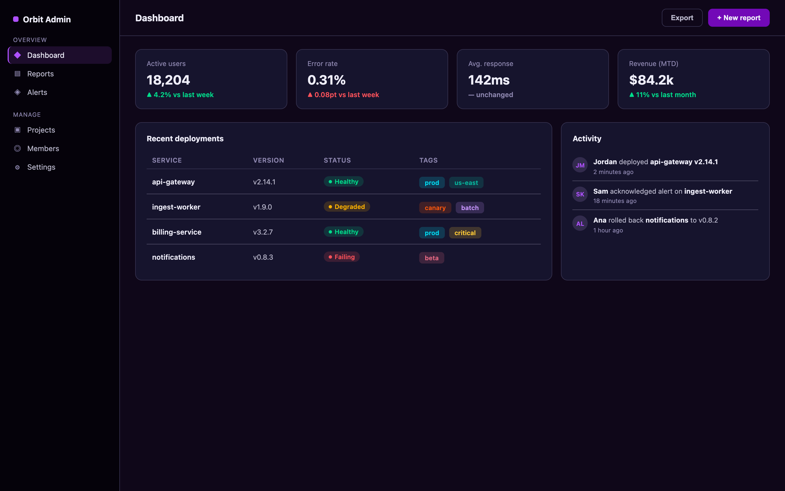
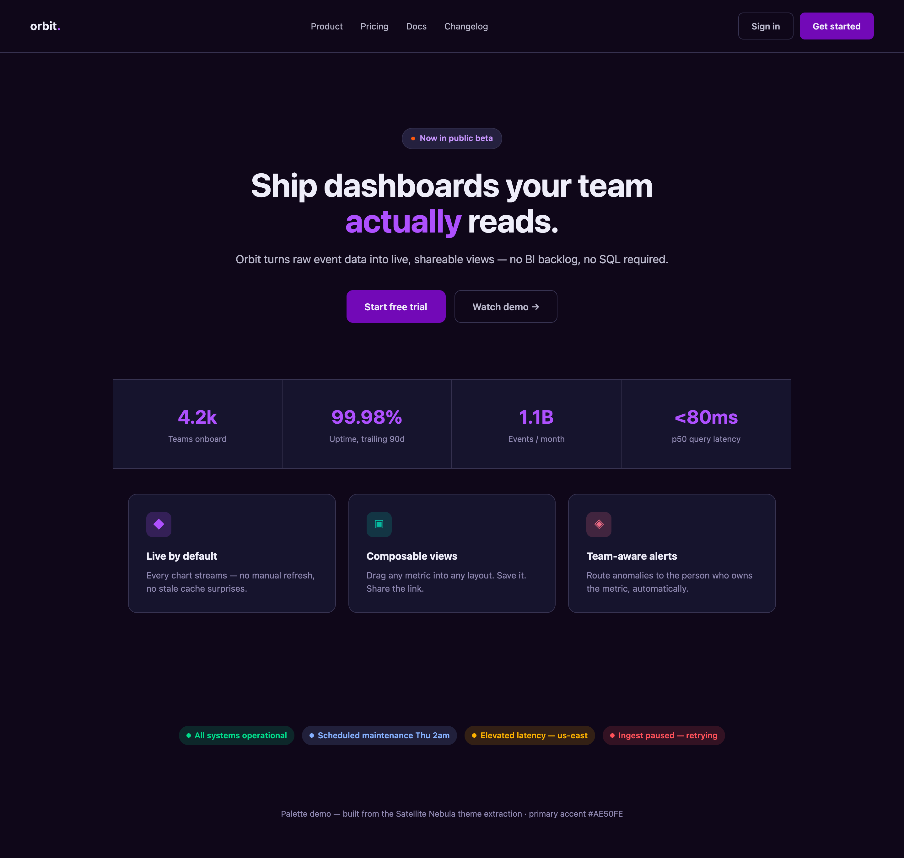

# Satellite Nebula

A dark colour palette: a violet ground, a purple primary accent, a warm orange
counterpoint and a spread of neon secondaries. It started as the "Satellite Nebula"
variant of a VS Code theme, and every colour is named for its role rather than for an
editor widget, so the same look carries over to web pages, dashboards and apps.



*[`example-dashboard.html`](example-dashboard.html)*



*[`example-landing.html`](example-landing.html)*

## What's here

| Path | What it is |
| --- | --- |
| [`color-palette.json`](color-palette.json) | The palette, and the source of truth for every colour |
| [`example-dashboard.html`](example-dashboard.html), [`example-landing.html`](example-landing.html) | The sample pages above, each a single self-contained file |
| [`obsidian/`](obsidian/README.md) | An Obsidian theme generated from the palette, with its own README |

## Using the palette

The palette isn't a package or a stylesheet. Take the colours from
[`color-palette.json`](color-palette.json), where they're grouped by role:

- **`surface`**: the background ramp, from `void` (darkest) through `base`, `canvas`
  and `raised` to `elevated`.
- **`border`**: component borders and dividers, in `default`, `subtle` and `muted`.
- **`text`**: `primary`, `secondary` and `muted`, plus `onAccent` for text on an
  accent fill.
- **`accent`**: `primary` is the brand colour, `primaryDeep` its filled variant, and
  `secondary` the warm counterpoint.
- **`state`**: `error`, `warning`, `info` and `success`, each with an `Alt` fill
  variant.
- **`syntax`**: named neon hues for code, and for tags, chips and chart series that
  need many distinct colours.

Each colour's `use` says what it's for, and the `usageNotes` at the end of the file
explain how the groups work together. The example pages define the colours they use as
CSS custom properties (`--surface-base`, `--accent-primary-deep`, `--syn-cyan` and so
on), which is a good block to start from.

## Design rules

The example pages follow these rules. Keep them in anything built on the palette.

- **Elevation is the surface ramp plus a 1px border.** The page sits on
  `surface.base`, and cards and panels a step up on `surface.canvas`, edged with a 1px
  `border.default`. Nothing has a shadow.
- **Nothing animates.** There are no transitions or keyframes, so hover states snap.
- **The primary button rests on `accent.primaryDeep` and brightens to
  `accent.primary` on hover**, the reverse of the usual darken-on-hover. The secondary
  button is transparent, with `text.secondary` and a 1px `border.default` that turn
  `text.primary` and `border.muted` on hover.
- **Pills, tags, chips and icon tiles are tints:** their colour at 15–20% opacity,
  under text in the full colour.
- **There are no form controls.** The examples style buttons, but no text inputs,
  selects, checkboxes or toggles, so a project that needs them builds its own from the
  rules above.

## Checking a change

The colours are copied, not imported. A colour change goes into `color-palette.json`,
the `:root` block of each example page, and `obsidian/theme.css`
([its README](obsidian/README.md#structure-of-themecss) says where). Projects built on
the palette keep their own copies too.

Open the example pages in a browser and look them over. On macOS:

```sh
open example-dashboard.html example-landing.html
```

If the change alters how they look, retake the screenshots. This needs Node.js, and
drives your installed Chrome headlessly at 1440 × 900 and 2x, capturing the full page:

```sh
for page in example-dashboard example-landing; do
  npx playwright-core@1.64.1 screenshot --channel chrome --device "Desktop Chrome HiDPI" \
    --viewport-size 1440,900 --full-page "$page.html" "docs/$page.png"
done
```

To check the Obsidian theme, install it in a vault as
[its README](obsidian/README.md#install) describes.

## Used by

- [dotfiles](https://github.com/gcrevell/dotfiles): its Claude Code theme and status
  line, and the zsh prompt.

## License

[MIT](LICENSE)
